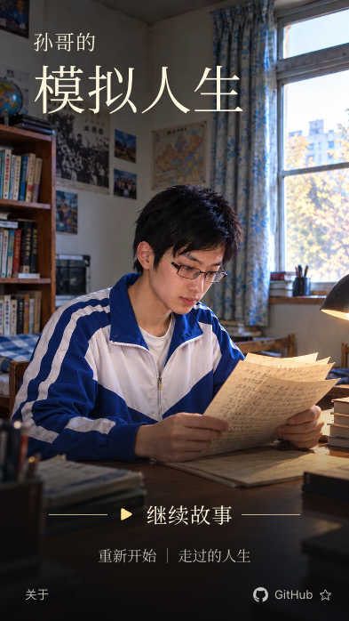
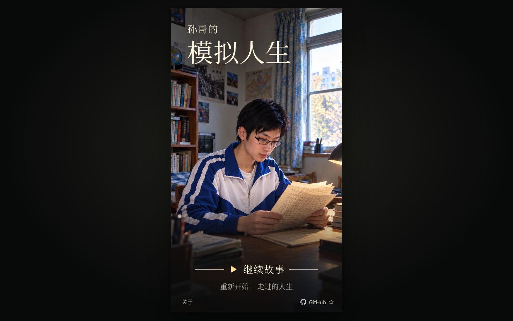

# 首页改版 · 2026-10-25

版本 1.0.3。用户确认了海报式首页，并将名称改为「孙哥的模拟人生」。

本轮使用独立无字封面，将标题放在上方，开始或继续操作放在下方，移除首页标语、年代、结局数量和说明段落。说明仍可从「关于」阅读。右下角 GitHub 链接打开公开仓库，附空心星标，不自动为玩家点星。

封面用内置 image_gen 按获确认的效果图移除界面文字后生成。正式 WebP 为 941×1672，152,208 字节。标题、菜单与链接均为真实界面。场景照片、120 个剧情节点、选择和存档格式沿用上一版；仍保留电脑居中竖屏与手机旋转适配。

## 本地验收

- 逐项核对后确认，120 个剧情节点和 86 张原有照片与上一版一致。
- 内容检查与 15 项单元测试通过。片头新增的无字封面独立管理，不占用剧情照片。
- 对照获确认的效果图，按同样的 393×698 竖屏与续读状态进行并排比较；第一轮发现标题偏低偏大、主操作偏高，调整后再次比较，所需修订已完成。
- 首页在 393×698、390×844、320×568、943×421、1440×900 下可读，按钮和页脚链接都在画框内，触摸区域至少 44px。另用触屏上下文检查 844×390 横放及转回 390×844。
- 开始、刷新续读、关于、焦点返回、GitHub 目标与新标签页属性、慢图等待与恢复通过生产预览检查。

最初的完整开发回归有 32 项通过、2 项失败。其中一次是生成资产时触发开发热更新，打断了游戏初始化；另一项测试刻意阻塞了预载照片，却同时等待该照片载入，修正为等待 DOM 就绪。受影响的游戏流程和加载用例均在稳定的生产构建中重跑通过；最终首页用例也在排版调整后重跑通过。完整 CI 与公开地址结果待发布后补齐，不能把这轮本地开发回归记作一次全部通过。

字体只随游戏提供标题和菜单所需的 Noto Serif SC 字形（4,516 字节），不依赖在线字体请求。图标与字体保留各自的许可。

## 公开版本验收

1.0.3 已发布到 [在线试玩](https://shanedevpro.github.io/sun-life-simulator/)。网站代码为提交 `53f4478eae2b3023819dace216ab287d39a41d67`；[发布工作流](https://github.com/ShanedevPro/sun-life-simulator/actions/runs/40199098559) 完成，15 项单元测试、34 项浏览器测试全部通过。

直接在公开 HTTPS 地址重跑两项首页检查，开始、续读、关于、GitHub 链接、五种视口及触屏旋转均通过。页面显示新名，封面、字体、CSS 和两个 JavaScript 文件共五个文件与本次构建的 SHA-256 一致，见 [运行文件核对](runtime-files.json) 与 [发布记录](deployment.json)。上面的两张截图也已替换成公开地址的实际画面。

用户现有的浏览器标签页已经刷新，当前显示新版首页，并可继续原来的进度。桌面快捷方式所用的本地根路径构建也已更新。后续文档提交只补验收记录，不替换本次已发布的运行产物。

完整结果见 [检查记录](verification.json)。检查使用桌面浏览器和模拟触屏，实体手机尚未实测。
